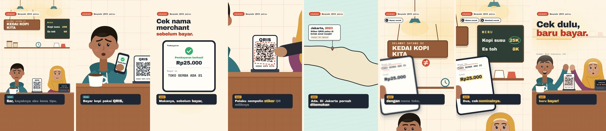
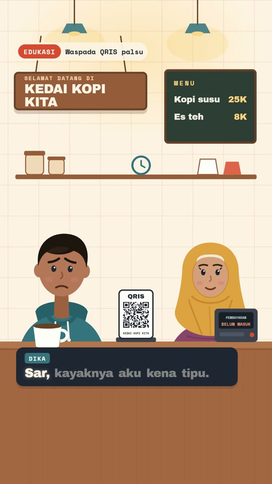
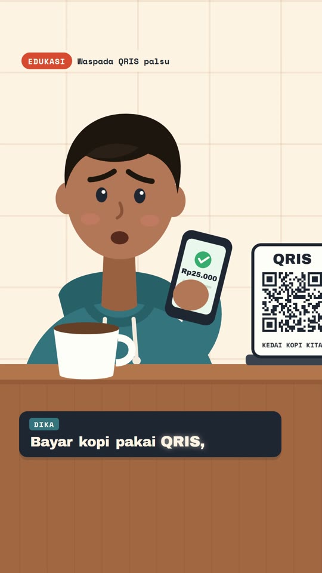
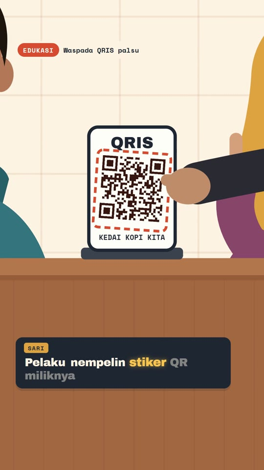
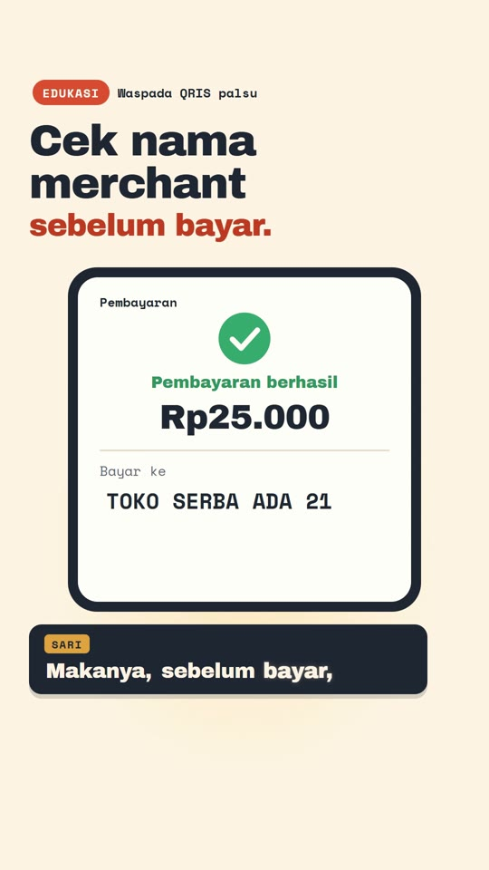
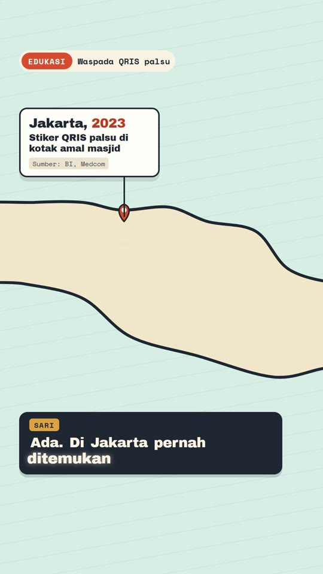
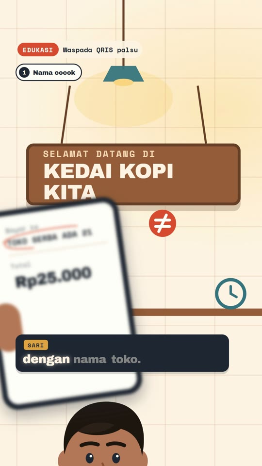
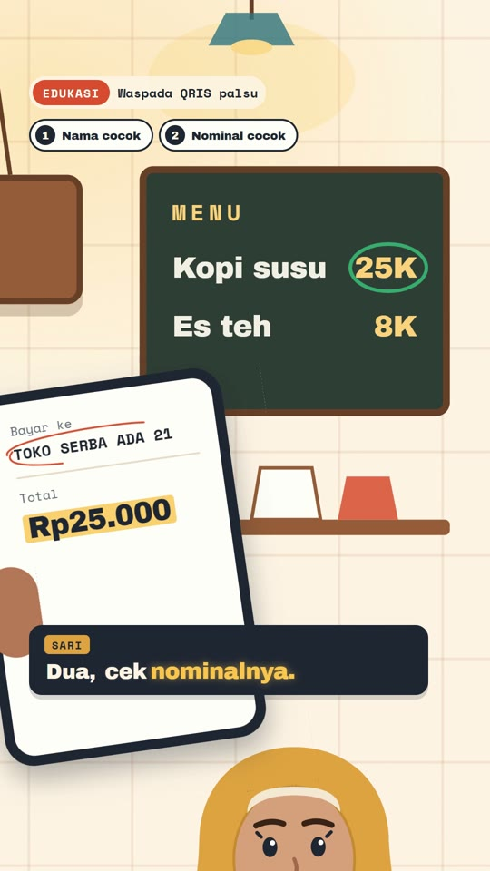
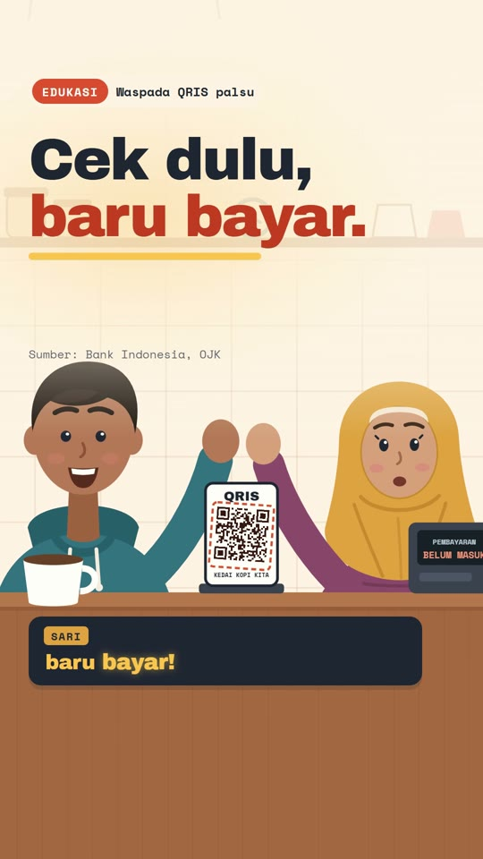
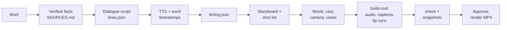

<div align="center">

# Dialog Explainer Motion

**An agent skill for two-character dialogue explainers that move like film, not slides.**<br>
Two illustrated characters talk; the camera works inside one world, cutting to whoever speaks and to whatever they point at. Voices, lip-sync, karaoke captions, and a music bed carved under the dialogue, rendered to MP4 with [HyperFrames](https://hyperframes.heygen.com).

[](LICENSE)
[](#install)
[](CHANGELOG.md)
[](#install)



</div>

## What it makes

A 30-90 second vertical (9:16) explainer for Reels, TikTok, or Shorts, built as an HTML
composition and rendered to MP4:

- **Two characters in one world.** Half-body vector characters behind a counter, with expressions,
  blinking, breathing, arm poses, and a high five. Mouths move per syllable from TTS word timestamps.
- **A camera that tells the story.** Wide establishing shot, push-ins on the speaker, close-ups on
  the object being mentioned, pans, cuts to the listener's reaction, a push-through into a phone
  screen, over-the-shoulder shots with rack focus, and a pull-back for the ending. Every move is
  locked to a spoken word.
- **Cut-away views and overlays** for what the world can't show: an insert of a phone screen,
  a money-flow diagram, a map with case pins, a checklist, steps arriving as notifications.
- **Karaoke captions** placed above the app UI safe zone, with keywords highlighted.
- **Fact discipline.** The workflow requires verified sources for every claim and keeps a
  `SOURCES.md` with the video.

The included example (`examples/qris-palsu`) is a 64-second Indonesian public-education piece on
fake QRIS payment stickers. The skill's instructions are written in Indonesian; the videos can be
in any language your TTS voices support.

## Gallery

<table>
<tr>
<td width="25%"><br><sub>Establishing shot of the world</sub></td>
<td width="25%"><br><sub>Push-in on the speaker and his phone</sub></td>
<td width="25%"><br><sub>Close-up: the scam happens in the world</sub></td>
<td width="25%"><br><sub>Push-through into a phone insert</sub></td>
</tr>
<tr>
<td><br><sub>Map as an instrument for real cases</sub></td>
<td><br><sub>Over-the-shoulder rack focus</sub></td>
<td><br><sub>Pan to the menu price</sub></td>
<td><br><sub>Pull-back to the tagline</sub></td>
</tr>
</table>

## Requirements

| To... | You need |
|---|---|
| Build and render | Any coding agent that can run shell commands and read files, Node 18+, ffmpeg, and the HyperFrames skills: `npx hyperframes skills update general-video` |
| Voices with word timestamps | Either the [HeyGen CLI](https://developers.heygen.com/cli), signed in with your own account (`scripts/tts.mjs`; on Windows, install it in WSL and set `HEYGEN_WSL=1`), or audio from anywhere (another TTS, a recorded voice-over) plus `scripts/align.mjs`, which reads ElevenLabs alignment, any word-timestamp JSON, or runs local whisper through `hyperframes transcribe`. |
| Carve the music under the voices | `@hyperframes/core` as a devDependency of the video project |
| Audit the choreography | `@hyperframes/producer` as a devDependency of the video project |

Voices and music are generated or licensed under **your** account. None are shipped in this repo.

## Install

The skill follows the open **Agent Skills** layout (a folder with `SKILL.md`, `references/`,
`scripts/`, `assets/`), so any agent that reads skills can use it.

### Any agent (recommended)

```bash
npx skills add rifqiadit10/dialog-explainer-motion -g
```

The [skills CLI](https://skills.sh) detects the agents on your machine and links the skill into
each one's skills folder. Pass `-a '*'` to install for every detected agent, or `-a <agent>` for one.
Detected agents include Claude Code, GitHub Copilot, Gemini CLI, Antigravity, OpenCode,
Windsurf, Qwen Code, and Command Code, plus the shared `~/.agents/skills` folder; see
[skills.sh](https://skills.sh) for the current list.

### Claude Code plugin

```
/plugin marketplace add rifqiadit10/dialog-explainer-motion
```
```
/plugin install dialog-explainer-motion@dialog-explainer-motion
```

### Manual

```bash
git clone https://github.com/rifqiadit10/dialog-explainer-motion
```

Then point your agent at it:

| Agent | Where it goes |
|---|---|
| Agents with a skills folder | copy or link the folder into that folder (for example `~/.claude/skills/dialog-explainer-motion` or `~/.agents/skills/dialog-explainer-motion`) |
| Agents that read `AGENTS.md` (Codex and others) | add: *"For two-character dialogue explainer videos, read and follow `<path>/dialog-explainer-motion/SKILL.md`."* |
| Gemini CLI without skills | add the same line to `GEMINI.md` |
| Cursor | add the same line as a rule in `.cursor/rules` |
| Plain chat, no agent | paste `SKILL.md` and the relevant file from `references/` as instructions; the scripts need a shell |

Install one copy per agent: two copies with the same skill name conflict.

## Example prompts

```text
Make a 60-second Reels video where two friends chat about how to spot a phishing link, Indonesian.
```
```text
Buat video 45 detik dua karakter ngobrol soal cara aman pakai pinjol legal, 9:16, sumber dari OJK.
```
```text
A 30-second dialogue explainer for our clinic: a patient asks the nurse how online queueing works.
```
```text
Video dialog ini terasa statis seperti slide, perbaiki kamera dan shot-nya.
```

## How it works



Voice timing drives everything: `scripts/timing.mjs` lays the lines on one clock, and camera shots,
poses, and clips are written as word cues instead of seconds:

```js
[cue("f5-2-sari:dua -0.03"), 0.7, 1.9, MENU, [640, 640], "power3.inOut"], // "Dua": the menu price
```

`build-root.mjs` resolves and checks every cue against `audio/timing.json`, so a new voice take,
another voice, or different pauses move the whole choreography with it.

## Repository layout

```
SKILL.md                    workflow and rules (read by the agent, Indonesian)
references/                 camera, cast, audio, captions, facts, known pitfalls
scripts/
  tts.mjs                   HeyGen TTS with word timestamps (WSL-aware)
  align.mjs                 word timestamps for audio from any source (ElevenLabs, JSON, local whisper)
  timing.mjs                lays lines on one timeline, derives frame windows
  build-root.mjs            injects audio, caption cards, lip-sync data, and word cues
assets/starter/             runnable 20 s demo: camera rig, world, cast, one view/overlay/tagline
examples/qris-palsu/        full reference project (code, script, storyboard, sources; no media)
docs/gallery/               stills from the example render
.claude-plugin/             Claude Code plugin + marketplace manifests
```

## Notes

- Characters, world, and graphics are original vector drawings in this repo (MIT).
- Fonts (Archivo Black, Space Mono) are resolved by HyperFrames at render time.
- The QR patterns in the example are random decoration and cannot be scanned. Official logos are
  not used; names are written as text.
- The example's facts were checked against Bank Indonesia, OJK, and major Indonesian media on
  2026-10-21; see `examples/qris-palsu/SOURCES.md`. Re-verify before publishing anything new.

## Credits

Built on [HyperFrames](https://hyperframes.heygen.com) by HeyGen and its skills
(`hyperframes-core`, `hyperframes-animation`, `hyperframes-audio`, `media-use`). The anti-slide
camera rules were sharpened with [bang-motion](https://github.com/bangtutorial/bang-motion).

## License

[MIT](LICENSE)
